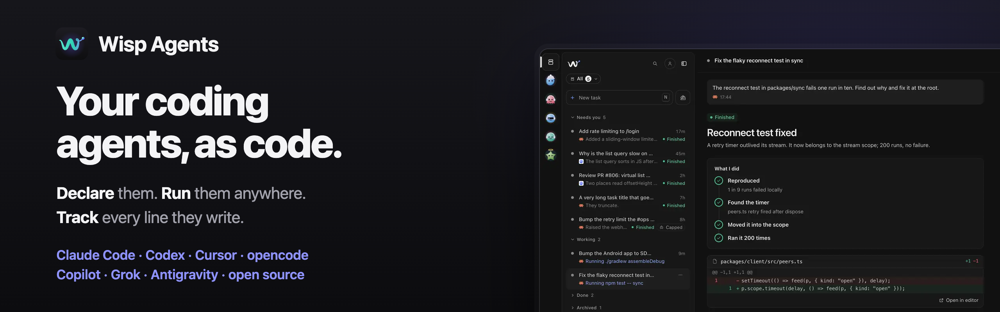

<p align="center">
  <a href="https://trywisp.dev/"></a>
</p>

<p align="center">
  <a href="https://trywisp.dev/"><b>trywisp.dev</b></a> ·
  <a href="https://trywisp.dev/docs/">Docs</a> ·
  <a href="https://trywisp.dev/app.html">Download</a> ·
  <a href="https://trywisp.dev/cloud.html">Cloud</a> ·
  <a href="https://trywisp.dev/changelog.html">Changelog</a> ·
  <a href="https://x.com/trywispagents">@trywispagents</a>
</p>

We are **Wisp Agents** ([trywisp.dev](https://trywisp.dev/)). We build wisp (your coding agents, as code) and the small tools around it, for people who run coding agents all day. All of it is free and open source.

### Wisp Agents

**[WispAgents/wisp](https://github.com/WispAgents/wisp)** runs the coding agents you already use (Claude Code, Codex, Cursor, opencode, Copilot, Grok and Antigravity), signed in with your own plans and keys:

- **Declare.** Your agents, crew, machines, skills, MCP servers, rules and workflows as files in your repo's `.wisp/` folder. `wisp plan` shows what changes, `wisp apply` makes it so.
- **Run.** Any agent, many at once, each task in its own git worktree, on this computer, your other computers or in [the cloud](https://trywisp.dev/cloud.html). Read a one-screen report instead of the transcript.
- **Track.** Every task is kept next to the code it wrote. `wisp blame` tells you which task wrote a line and what it was asked.

Desktop app (macOS, Windows, Linux), phone app, TUI and CLI, and from your own agent through wisp's MCP tools.

### Tools

| | |
|---|---|
| **[worktrash](https://github.com/WispAgents/worktrash)** | The git worktrees your agents left behind: see what they hold and what they cost on disk, remove the ones that hold nothing. Branches always stay. |
| **[decision-ledger](https://github.com/WispAgents/decision-ledger)** | A reviewed ledger of your project's decisions, shown to agents before each edit and enforced by hooks, pre-commit and CI. |
| **[ingrain](https://github.com/WispAgents/ingrain)** | Turns the corrections you keep making to agent code into lint rules, checked at edit time, before commit and in CI. |
| **[monoflow](https://github.com/WispAgents/monoflow)** | A monorepo and CI environment built for agents: see what a change reaches, verify only that. |

### Try it

```sh
npx wisp-agents
```

Or `npm install -g wisp-agents`, `brew install --cask wispagents/tap/wisp`, `curl -fsSL https://trywisp.dev/install.sh | bash`, or grab the [desktop app](https://trywisp.dev/app.html). wisp is in alpha: [tell us what breaks](https://github.com/WispAgents/wisp/issues).
