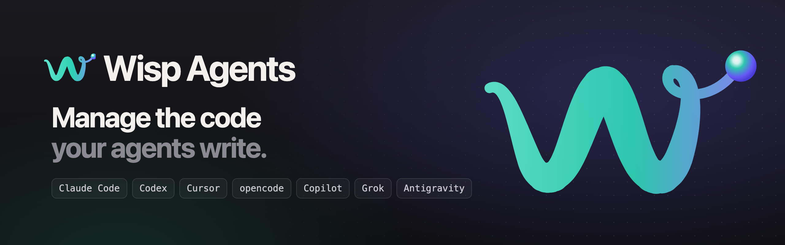

<p align="center">
  <a href="https://trywisp.dev/"></a>
</p>

<p align="center">
  <a href="https://trywisp.dev/"><b>trywisp.dev</b></a> ·
  <a href="https://trywisp.dev/docs/">Docs</a> ·
  <a href="https://trywisp.dev/app.html">Download</a> ·
  <a href="https://x.com/trywispagents">@trywispagents</a>
</p>

We are **Wisp Agents** ([trywisp.dev](https://trywisp.dev/)). We build wisp, an app that manages the code your coding agents write, and the small tools around it, for people who run coding agents all day. All of it is free and open source (MIT).

### Projects

- **[Wisp Agents](https://trywisp.dev/)** ([source](https://github.com/WispAgents/wisp)): declare your agents as code, run Claude Code, Codex, Cursor, opencode, Copilot, Grok and Antigravity in parallel, in the background, on any of your machines, and read a one-screen report instead of the transcript, and track every line they write. Desktop app, TUI, CLI and [Wisp Agents Cloud](https://trywisp.dev/cloud.html).
- **[worktrash](https://github.com/WispAgents/worktrash)**: the git worktrees your agents left behind. See what they hold and what they cost on disk, and remove the ones that hold nothing. Branches always stay.
- **[monoflow](https://github.com/WispAgents/monoflow)**: a monorepo and CI environment built for agents.
- **[decision-ledger](https://github.com/WispAgents/decision-ledger)**: a reviewed decision ledger that stops coding agents from undoing what you decided.
- **[ingrain](https://github.com/WispAgents/ingrain)**: turn the corrections you keep making to agent code into lint rules.

### Try Wisp Agents

```sh
npx wisp-agents
```

Or `npm install -g wisp-agents`, `brew install --cask wispagents/tap/wisp`, or grab the [desktop app](https://trywisp.dev/app.html).

Issues, ideas and PRs are welcome on [WispAgents/wisp](https://github.com/WispAgents/wisp/issues).
